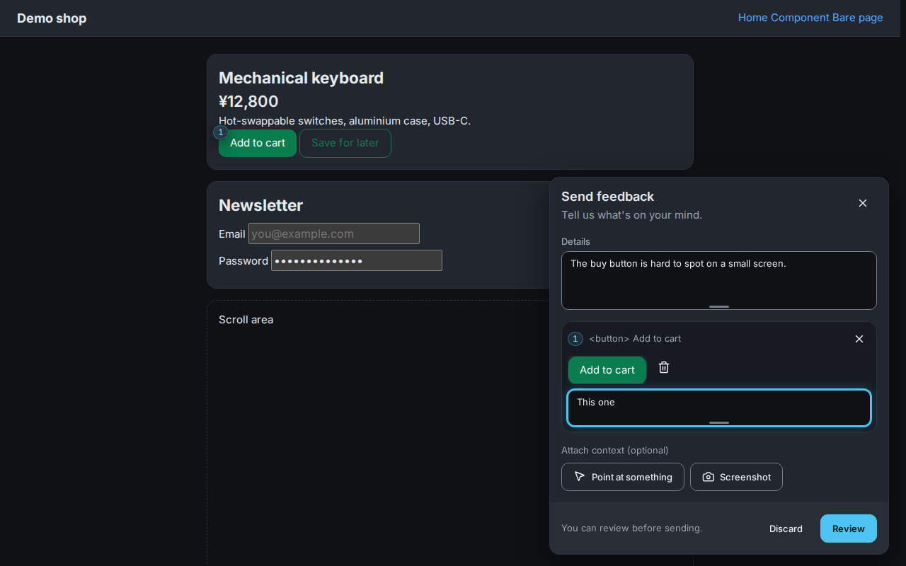
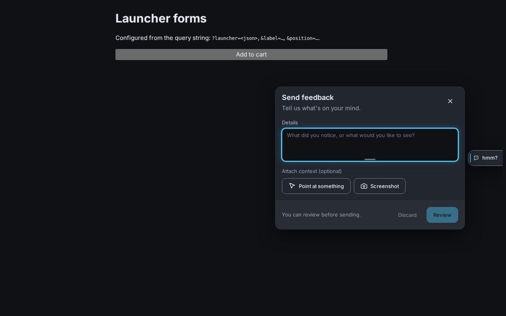

# @dorsk/hmm

A feedback panel for Svelte 5 apps built on [tsumikit](https://github.com/DorskFR/tsumikit). The
user opens "Send feedback", selects elements on the page, comments on them, adds screenshots,
reviews exactly what will be sent, and sends it to an endpoint you own.

The panel is made of tsumikit components (`Card`, `Button`, `Field`, `Textarea`, `Disclosure`, …), so
it has no palette, font or control shapes of its own: it looks like the app it is in and follows
its theme.



## Install

```sh
npm install @dorsk/hmm
```

`svelte` (^5) and `@dorsk/tsumikit` (>=0.82.0 <1) are peer dependencies: the panel is rendered by
the copies your app already has. The app must load tsumikit's stylesheet, as any tsumikit app does.

```svelte
<script lang="ts">
	import { Hmm } from '@dorsk/hmm';
</script>

<Hmm
	projectKey="my-app"
	endpoint="https://feedback.example.com"
	context={() => ({ appVersion: '1.4.2', route: currentRouteName() })}
/>
```

Render it once, near the root of the app. By default a "hmm?" pill floats in the bottom-right
corner; [Launchers](#launchers) shows the other ways to open it.

Outside a Svelte tree, `init` mounts the same component on `<body>`:

```ts
import { init } from '@dorsk/hmm';

const feedback = init({ projectKey: 'my-app', endpoint: 'https://feedback.example.com' });
feedback.open();
```

`init` returns `{ open(), close(), destroy(), isOpen }`. Calling it again replaces the previous
instance.

## Launchers



The `launcher` prop picks how the panel is opened. Each built-in form shows an icon and the
`labels.launcher` text (`hmm?` by default). With `labels={{ launcher: '' }}` it is icon only, and
`labels.title` ("Send feedback") becomes its accessible name and tooltip. The panel opens next to
the launcher, on the same side, and stays inside the viewport.

**Floating** sits on top of the page, in a corner or at the middle of an edge.

```svelte
<Hmm … launcher={{ form: 'floating', anchor: 'bottom-left', look: 'icon' }} />
```

`anchor` is one of `top-left`, `top`, `top-right`, `left`, `right`, `bottom-left`, `bottom` or
`bottom-right`. `look` is `pill` (default), `icon` or `button` (the primary colour).

**Edge tab** is pushed off-screen against an edge, so only a thin strip with an accent grip shows.
It slides in on hover or keyboard focus. On touch screens, the first tap slides it in and the second
opens the panel.

```svelte
<Hmm … launcher={{ form: 'edge', side: 'right', align: 'end' }} />
```

`side` is `top`, `right`, `bottom` or `left`; `align` is `start`, `center` (default) or `end`
along that edge.

**Corner bubble** is tucked into a corner and slides out diagonally, with its label.

```svelte
<Hmm … launcher={{ form: 'corner', corner: 'bottom-right' }} />
```

A `launcherContent` snippet replaces the icon and label inside any of the three.

**Your own button**: set `launcher={false}` and open the panel from anywhere in the app, inside or
outside the component that renders `<Hmm>`.

```svelte
<script lang="ts">
	import { HmmTrigger, hmm } from '@dorsk/hmm';
</script>

<HmmTrigger />                                   <!-- "hmm?" pill -->
<HmmTrigger look="icon" panel="top-right" />     <!-- icon button; panel opens top-right -->
<HmmTrigger look="link">Something off? Tell us</HmmTrigger>
<HmmTrigger>
	{#snippet custom({ open })}<button class="fancy" onclick={open}>Report a bug</button>{/snippet}
</HmmTrigger>

<MenuItem onclick={() => hmm.open()}>Send feedback…</MenuItem>
```

`HmmTrigger` takes `look` (`pill`, `icon`, `button` or `link`), `label`, `title`, `panel` (the
corner the panel opens in, `bottom-right` by default) and any tsumikit `Button` prop. `hmm` has
`open(corner?)`, `close()`, `toggle(corner?)` and `isOpen`. It drives the most recently mounted
panel. `bind:open` on `<Hmm>` keeps working too.

## Props

`init` takes the same fields as an object.

| Prop | Type | Purpose |
|---|---|---|
| `projectKey` | `string` | Required. Public identifier of the project, sent with every report. Letters, digits, `.`, `_` and `-`. |
| `endpoint` | `string` | Base URL of the ingest server. Required unless `transport` is set. |
| `transport` | `(envelope) => Promise<void>` | Replaces the HTTP POST, for hosts that relay reports through their own backend. Throw an error with `retryable: false` to mark a permanent failure. |
| `context` | `() => object` | Extra data added to every report. May be async. |
| `beforeSend` | `(envelope) => envelope \| null` | Change a report, or drop it by returning `null`. Runs before the review, so the user sees the result. |
| `launcher` | `false \| Launcher` | How the panel is opened; see [Launchers](#launchers). `false` leaves it to `HmmTrigger`, `hmm.open()` or `bind:open`. |
| `launcherContent` | `Snippet` | Replaces the icon and label inside the built-in launcher. |
| `position` | `'bottom-right' \| 'bottom-left'` | Deprecated: use `launcher={{ form: 'floating', anchor }}`. |
| `labels` | `Partial<Labels>` | Override any text. The defaults are exported as `LABELS`. |
| `onSent` | `(envelope) => void` | Called after a report is delivered. |
| `open` | `boolean` | Bindable. Whether the panel is shown. |

## Styling

Colours, spacing, radii and type come from the tsumikit tokens in scope where `Hmm` is rendered, so
a `data-theme` switch or a token override on an ancestor applies to the panel too. The panel sits
at `--z-toast`; set `--hmm-z-index` on an ancestor to move it. `--hmm-offset-x` and
`--hmm-offset-y` shift the launcher, for example above a mobile bottom bar, and `--hmm-peek` sets
how much of an edge tab shows at rest (`--sp-2` by default). `[data-hmm-launcher]` and
`[data-hmm-trigger]` are there for one-off overrides.

## What is sent

One JSON document, the envelope, described by
[`schema/envelope.v1.json`](schema/envelope.v1.json) and by the `Envelope` type.

```jsonc
{
	"v": 1,
	"id": "b6f0c9a2-…",
	"kind": "feedback",            // "error" and "alert" are reserved for non-widget clients
	"category": "idea",            // optional: idea | problem | question | other; the panel does not set it
	"project": "my-app",
	"createdAt": "2026-11-12T08:00:00.000Z",
	"client": { "name": "@dorsk/hmm", "version": "0.1.0" },
	"page": { "url": "…", "title": "…", "viewport": { "width": 1280, "height": 800 }, "userAgent": "…", "language": "en" },
	"context": { "appVersion": "1.4.2" },
	"comment": "What about a dark mode?",
	"items": [
		{ "id": "…", "type": "element", "url": "…", "comment": "…", "target": { "selector": "#buy", "tag": "button", "text": "…", "html": "…", "attrs": {}, "rect": {} }, "attachment": "…" },
		{ "id": "…", "type": "screenshot", "url": "…", "comment": "", "attachment": "…" }
	],
	"attachments": [{ "id": "…", "mime": "image/png", "width": 1280, "height": 800, "data": "<base64>" }]
}
```

Limits: 20 items, 10 attachments, about 2 MB per image, 5,000 characters per comment, 16,000
characters of serialised context. They are exported as `LIMITS`.

## HTTP contract

```
POST <endpoint>/v1/reports
content-type: application/json
x-hmm-key: <projectKey>

<envelope>
```

- Any `2xx` answer counts as delivered.
- `408`, `429`, `5xx` and network errors are retried: the report is stored in `localStorage` and
  sent on the next page load or when the browser comes back online. At most five reports wait.
- Any other `4xx` is a permanent failure. The user sees an error and keeps the draft.
- The server must answer the CORS preflight and allow the `content-type` and `x-hmm-key` headers.
- No cookies or credentials are sent.

Servers can reuse the validator without pulling in any DOM code:

```ts
import { validateEnvelope } from '@dorsk/hmm/envelope';

const result = validateEnvelope(JSON.parse(body));
if (!result.ok) return reject(result.errors);
```

Treat every field as untrusted input. The validator checks structure and size only; it does not
make the text safe to render or to hand to an agent, and it does not decode the images.

## Privacy

- Nothing leaves the page until the user presses Send on the review screen, which lists every
  field and image, with the raw JSON one click away.
- Before the review, all text is scrubbed of JWTs, bearer tokens, common API key formats, private
  keys and `password=`-style pairs. URLs lose their credentials and secret-looking query
  parameters. `redactText`, `redactUrl` and `redactEnvelope` are exported.
- The HTML of an element is not recorded when it is, or contains, a password field.
- Screenshots cannot be scrubbed. They are shown in the review and each one can be removed.

## Limitations

- Svelte 5 and tsumikit only. A page without tsumikit's stylesheet renders the panel unstyled.
- An open `<dialog>` modal makes the rest of the page inert, the panel included.
- Screenshots are rendered from the DOM, not captured from the screen. Cross-origin images without
  CORS, `<video>`, and canvases tainted by cross-origin content come out blank.
- A strict Content Security Policy must allow `data:` in `img-src` for the thumbnails.
- Elements inside iframes or closed shadow roots cannot be selected.

## Development

```sh
npm install
npm run demo     # demo shop on http://localhost:4188 with an in-memory receiver
npm test         # unit tests and Chromium browser tests
npm run lint     # biome and tsumikit-lint
npm run check    # svelte-check
```

MIT licensed.
