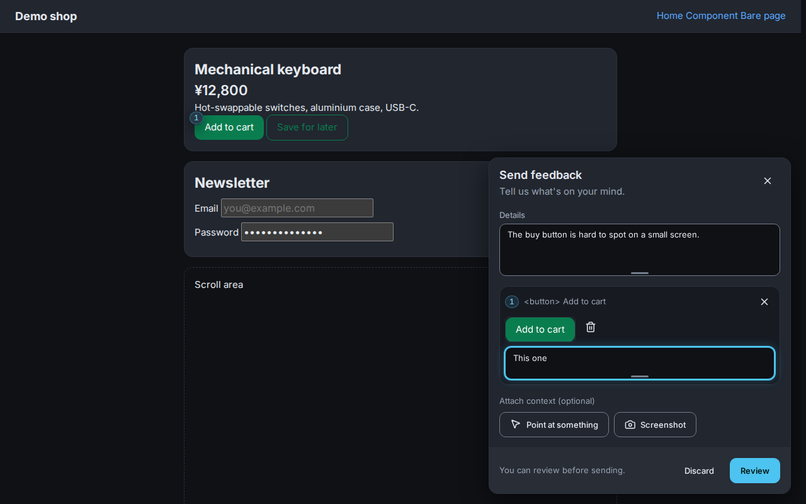
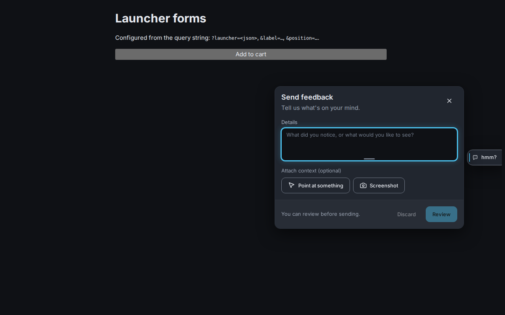

# @dorsk/hmm

A feedback panel for Svelte 5 apps built on [tsumikit](https://github.com/DorskFR/tsumikit). The
user opens "Send feedback", selects elements on the page, comments on them, adds screenshots or
images from their device, reviews exactly what will be sent, and sends it to an endpoint you own.

The panel is made of tsumikit components (`Card`, `Button`, `Field`, `Textarea`, `Disclosure`, …), so
it has no palette, font or control shapes of its own: it looks like the app it is in and follows
its theme.



## Install

```sh
npm install @dorsk/hmm
```

`svelte` (^5) and `@dorsk/tsumikit` (>=0.82.0 <1) are peer dependencies: the panel is rendered by
the copies your app already has. The app must load tsumikit's stylesheet, as any tsumikit app does.

```svelte
<script lang="ts">
	import { Hmm } from '@dorsk/hmm';
</script>

<Hmm
	projectKey="my-app"
	endpoint="https://feedback.example.com"
	context={() => ({ appVersion: '1.4.2', serverVersion, route: currentRouteName() })}
/>
```

Render it once, near the root of the app. By default a "hmm?" pill floats in the bottom-right
corner; [Launchers](#launchers) shows the other ways to open it.

The component never throws. With an invalid `projectKey`, or with neither `endpoint` nor
`transport`, it logs one `[hmm]` error to the console and renders nothing. An empty or blank
`endpoint` string turns it off quietly, so a runtime config can pass its value straight through.

For French, pass `labels={LABELS_FR}` (also exported); spread it to change a few strings.

Outside a Svelte tree, `init` mounts the same component on `<body>`:

```ts
import { init } from '@dorsk/hmm';

const feedback = init({ projectKey: 'my-app', endpoint: 'https://feedback.example.com' });
feedback.open();
```

`init` returns `{ open(), close(), destroy(), isOpen }`. Calling it again replaces the previous
instance. Unlike the component, `init` throws on invalid options.

### Without Svelte or tsumikit

`@dorsk/hmm/standalone` is one script with Svelte, the panel and a scoped copy of tsumikit's
tokens inside. It exposes `Hmm.init`, `Hmm.hmm`, `Hmm.LABELS`, `Hmm.LABELS_FR` and `Hmm.VERSION`:

```html
<script src="https://cdn.jsdelivr.net/npm/@dorsk/hmm@0.8.1/dist/standalone/hmm.js"></script>
<script>
	Hmm.init({ projectKey: 'my-app', endpoint: 'https://feedback.example.com' });
</script>
```

The tokens and element defaults apply under `[data-hmm]` only, so the page keeps its own colours,
fonts and resets. `data-theme` on `<html>` (or any ancestor) picks a tsumikit theme for the panel.

A Svelte app that does not load tsumikit's stylesheet can import the same scoped styles instead
and render `<Hmm>` as usual (`@dorsk/tsumikit` is still needed as a peer dependency):

```ts
import '@dorsk/hmm/scoped.css';
```

## Launchers



The `launcher` prop picks how the panel is opened. Each built-in form shows an icon and the
`labels.launcher` text (`hmm?` by default). With `labels={{ launcher: '' }}` it is icon only, and
`labels.title` ("Send feedback") becomes its accessible name and tooltip. The panel opens next to
the launcher, on the same side, and stays inside the viewport.

**Floating** sits on top of the page, in a corner or at the middle of an edge.

```svelte
<Hmm … launcher={{ form: 'floating', anchor: 'bottom-left', look: 'icon' }} />
```

`anchor` is one of `top-left`, `top`, `top-right`, `left`, `right`, `bottom-left`, `bottom` or
`bottom-right`. `look` is `pill` (default), `icon` or `button` (the primary colour).

**Edge tab** is pushed off-screen against an edge, so only a thin strip with an accent grip shows.
It slides part way out as the mouse comes near, fully on hover or keyboard focus, and it reacts to
an invisible strip along the edge that is wider than what is drawn. On touch screens, swipe inward
in that strip to pull it out and back toward the edge to tuck it away; a tap also works, the first
slides it in and the second opens the panel.

```svelte
<Hmm … launcher={{ form: 'edge', side: 'right', align: 'end' }} />
```

`side` is `top`, `right`, `bottom` or `left`; `align` is `start`, `center` (default) or `end`
along that edge.

**Corner bubble** is tucked into a corner and slides out diagonally, with its label. It peeks out
as the mouse comes near and can be swiped out of the corner like the edge tab.

```svelte
<Hmm … launcher={{ form: 'corner', corner: 'bottom-right' }} />
```

A `launcherContent` snippet replaces the icon and label inside any of the three.

**Moving it**: users can drag any of the three to another spot. On release it snaps to the nearest
place for its form: anywhere along any edge for an edge tab, the nearest corner for a corner
bubble, one of the eight anchors for a floating launcher. A dashed outline shows the target while
dragging. A click or tap still opens the panel. On touch, swiping inward still pulls a tab out;
dragging along the edge, or a long press then a drag, moves it. With keyboard focus on the
launcher, Alt and an arrow key move it (an edge tab walks along its edge and turns the corner at
its ends), and the new place is announced to screen readers.

The spot is remembered in `localStorage` under `hmm:launcher:<origin>:<projectKey>`, or under
`storageKey` when the app sets one, and comes back in later sessions. A stored edge position is
clamped back onto a smaller screen; a value that is invalid or meant for another form is ignored,
so the app's configuration stays the default. Double-clicking the launcher, or the reset button
in the panel header (shown while the launcher is moved), clears it.

```svelte
<Hmm … launcher={{ form: 'edge', side: 'right', storageKey: 'my-app:hmm-launcher' }} />
<Hmm … launcher={{ form: 'corner', corner: 'bottom-right', movable: false }} />
```

`movable: false` locks the launcher where the app put it and ignores any stored spot.

**Over modals**: at rest the launcher sits at `--hmm-z-index`, so an open modal covers it. When
the mouse comes near, the launcher gets focus, or a touch lands on it, it rises above
everything, and its panel stays above until it is closed. On touch, the first tap on a covered
tab raises it and slides it out; the next opens the panel. While a native `<dialog>` is open with
`showModal()`, the page behind it is inert, so `[data-hmm]` moves into the topmost modal dialog
and moves back when it closes, keeping the draft. Inside the dialog it shows above the backdrop,
and Escape in the panel closes the panel, not the dialog.

Modal libraries that trap focus or make the rest of the page `inert` need to let `[data-hmm]`
through, or the panel cannot be typed in: skip it when setting `inert` or `aria-hidden` on the
page, and have the trap's focus and click handlers ignore events from inside it:

```ts
if ((event.target as Element).closest('[data-hmm]')) return;
```

**Your own button**: set `launcher={false}` and open the panel from anywhere in the app, inside or
outside the component that renders `<Hmm>`.

```svelte
<script lang="ts">
	import { HmmTrigger, hmm } from '@dorsk/hmm';
</script>

<HmmTrigger />                                   <!-- "hmm?" pill -->
<HmmTrigger look="icon" panel="top-right" />     <!-- icon button; panel opens top-right -->
<HmmTrigger look="link">Something off? Tell us</HmmTrigger>
<HmmTrigger>
	{#snippet custom({ open })}<button class="fancy" onclick={open}>Report a bug</button>{/snippet}
</HmmTrigger>

<MenuItem onclick={() => hmm.open()}>Send feedback…</MenuItem>
```

`HmmTrigger` takes `look` (`pill`, `icon`, `button` or `link`), `label`, `title`, `panel` (the
corner the panel opens in, `bottom-right` by default) and any tsumikit `Button` prop. `hmm` has
`open(corner?)`, `close()`, `toggle(corner?)`, `isOpen`, and `mounted`, which is true while a
panel is rendered (a disabled or misconfigured `<Hmm>` does not count). It drives the most
recently mounted panel. `bind:open` on `<Hmm>` keeps working too.

## Props

`init` takes the same fields as an object.

| Prop | Type | Purpose |
|---|---|---|
| `projectKey` | `string` | Required. Public identifier of the project, sent with every report. Letters, digits, `.`, `_` and `-`. |
| `endpoint` | `string` | Base URL of the ingest server. Required unless `transport` is set. |
| `transport` | `(envelope) => Promise<void>` | Replaces the HTTP POST, for hosts that relay reports through their own backend. Throw an error with `retryable: false` (for example a `SendError`) to mark a permanent failure; the user then sees the `rejected` label. |
| `context` | `() => object` | Extra data added to every report. May be async. Prefer the keys `appVersion`, `serverVersion` and `route` (the route id or pattern, not the full path), so reports from different apps can be compared. |
| `beforeSend` | `(envelope) => envelope \| null` | Change a report, or drop it by returning `null`. Runs before the review, so the user sees the result. |
| `launcher` | `false \| Launcher` | How the panel is opened; see [Launchers](#launchers). `false` leaves it to `HmmTrigger`, `hmm.open()` or `bind:open`. |
| `launcherContent` | `Snippet` | Replaces the icon and label inside the built-in launcher. |
| `position` | `'bottom-right' \| 'bottom-left'` | Deprecated: use `launcher={{ form: 'floating', anchor }}`. |
| `labels` | `Partial<Labels>` | Override any text. The defaults are exported as `LABELS`, the French set as `LABELS_FR`. |
| `onSent` | `(envelope) => void` | Called after a report is delivered. |
| `open` | `boolean` | Bindable. Whether the panel is shown. |

## Styling

Colours, spacing, radii and type come from the tsumikit tokens in scope where `Hmm` is rendered, so
a `data-theme` switch or a token override on an ancestor applies to the panel too. The launcher
rests at `--z-toast`; set `--hmm-z-index` on an ancestor to move it. The open panel and an engaged
launcher sit at `--hmm-z-index-raised` (`2147483000` by default). `--hmm-offset-x` and
`--hmm-offset-y` shift the launcher, for example above a mobile bottom bar, and `--hmm-peek` sets
how much of an edge tab shows at rest (`--sp-2` by default). `--hmm-zone` sets how far the
invisible hit area of a tucked launcher reaches in from the edge (`--sp-8` by default).
`--hmm-inset-bottom` keeps the panel clear of a bottom bar; the device safe area is always kept
clear. These variables can be set on `:root`, so no wrapper element is needed:

```css
:root {
	--hmm-offset-y: var(--bottom-bar-height);
	--hmm-inset-bottom: var(--bottom-bar-height);
}
```

`[data-hmm-launcher]` and `[data-hmm-trigger]` are there for one-off overrides.

`[data-hmm]` wraps the panel and the launcher. Global keyboard shortcut handlers should skip
events from inside it, as they do for inputs:

```ts
if ((event.target as Element).closest('input, textarea, select, [data-hmm]')) return;
```

## Testing

These hooks are stable API; they only change in a major version.

| Selector | Element |
|---|---|
| `[data-hmm]` | Root of the panel and launcher |
| `[data-hmm-launcher]` | Built-in launcher; `data-state` is `tucked`, `peek` or `out` (floating launchers are always `out`) |
| `[data-hmm-trigger]` | `HmmTrigger` |
| `[data-id="launcher"]` | The launcher button; `launcher-label` is its text, `launcher-zone` the hit area of a tucked one |
| `[data-id="panel"]` | The dialog |
| `[data-id="comment"]` | Main comment field |
| `[data-id="pick"]`, `[data-id="shot"]`, `[data-id="upload"]` | Select an element, take a screenshot, add an image file |
| `[data-id="item"]` | One attached element or screenshot, with `item-label`, `item-comment`, `remove`, `remove-image` |
| `[data-id="discard"]`, `[data-id="review"]` | Edit view footer |
| `[data-id="review-body"]`, `[data-id="said"]`, `[data-id="raw"]` | Review view |
| `[data-id="back"]`, `[data-id="send"]` | Review view footer |
| `[data-id="result"]`, `[data-id="message"]`, `[data-id="done"]` | Done view |
| `[data-id="error"]` | Error message |
| `[data-id="close"]` | Close button |

Wait on these attributes rather than on positions: a tucked launcher slides, so pixel checks are
flaky. Pressing Enter on the launcher opens the panel with any launcher form, on desktop and on
touch devices. Route the endpoint and answer with CORS headers, since it is usually on another
origin:

```ts
import { expect, test } from '@playwright/test';

test('feedback reaches the server', async ({ page }) => {
	const reports: unknown[] = [];
	await page.route('https://feedback.example.com/v1/reports', async (route) => {
		const post = route.request().method() === 'POST';
		if (post) reports.push(route.request().postDataJSON());
		await route.fulfill({
			status: post ? 202 : 204,
			headers: {
				'access-control-allow-origin': '*',
				'access-control-allow-headers': 'content-type, x-hmm-key',
				'access-control-allow-methods': 'POST, OPTIONS',
			},
		});
	});
	await page.goto('/');

	const hmm = (id: string) => page.locator(`[data-hmm] [data-id="${id}"]`);
	await hmm('launcher').press('Enter');
	await hmm('comment').fill('The total looks wrong');
	await hmm('review').click();
	await hmm('send').click();
	await expect(hmm('result')).toBeVisible();
	expect(reports).toHaveLength(1);
});
```

To go through the pointer with a tucked launcher, hover its zone (the tab itself is mostly off
screen, so Playwright cannot aim at it) and wait for the state before clicking:

```ts
await hmm('launcher-zone').hover();
await expect(page.locator('[data-hmm-launcher]')).toHaveAttribute('data-state', 'out');
await hmm('launcher').click();
```

## What is sent

One JSON document, the envelope, described by
[`schema/envelope.v1.json`](schema/envelope.v1.json) and by the `Envelope` type.

```jsonc
{
	"v": 1,
	"id": "b6f0c9a2-…",
	"kind": "feedback",            // "error" and "alert" are reserved for non-widget clients
	"category": "idea",            // optional: idea | problem | question | other; the panel does not set it
	"project": "my-app",
	"createdAt": "2026-11-12T08:00:00.000Z",
	"client": { "name": "@dorsk/hmm", "version": "0.1.0" },
	"page": { "url": "…", "title": "…", "viewport": { "width": 1280, "height": 800 }, "userAgent": "…", "language": "en" },
	"context": { "appVersion": "1.4.2" },
	"comment": "What about a dark mode?",
	"items": [
		{ "id": "…", "type": "element", "url": "…", "comment": "…", "target": { "selector": "#buy", "tag": "button", "text": "…", "html": "…", "attrs": {}, "rect": {} }, "attachment": "…" },
		{ "id": "…", "type": "screenshot", "url": "…", "comment": "", "attachment": "…" }
	],
	"attachments": [{ "id": "…", "mime": "image/png", "width": 1280, "height": 800, "data": "<base64>" }]
}
```

Limits: 20 items, 10 attachments, about 2 MB per image, 5,000 characters per comment, 16,000
characters of serialised context. They are exported as `LIMITS`.

## HTTP contract

```
POST <endpoint>/v1/reports
content-type: application/json
x-hmm-key: <projectKey>

<envelope>
```

- Any `2xx` answer counts as delivered.
- `408`, `429`, `5xx` and network errors are retried: the report is stored in `localStorage` and
  sent on the next page load or when the browser comes back online. At most five reports wait.
- Any other `4xx` is a permanent failure. The user is told the app can't send feedback (the
  `rejected` label) and keeps the draft. The console gets the status and the `error` field of a
  JSON answer such as `{ "error": "unknown project" }`, with the project key and the page origin.
  `httpTransport` throws a `SendError` with `retryable`, `status` and `detail` (that `error` text).
- The server must answer the CORS preflight and allow the `content-type` and `x-hmm-key` headers.
- No cookies or credentials are sent.

Servers can reuse the validator without pulling in any DOM code:

```ts
import { validateEnvelope } from '@dorsk/hmm/envelope';

const result = validateEnvelope(JSON.parse(body));
if (!result.ok) return reject(result.errors);
```

Treat every field as untrusted input. The validator checks structure and size only; it does not
make the text safe to render or to hand to an agent, and it does not decode the images.

## Privacy

- Nothing leaves the page until the user presses Send on the review screen, which lists every
  field and image, with the raw JSON one click away.
- Before the review, all text is scrubbed of JWTs, bearer tokens, common API key formats, private
  keys and `password=`-style pairs. URLs lose their credentials and secret-looking query
  parameters. `redactText`, `redactUrl` and `redactEnvelope` are exported.
- The HTML of an element is not recorded when it is, or contains, a password field.
- Screenshots and added images cannot be scrubbed. They are shown in the review and each one can be removed.

## Limitations

- Pages without tsumikit's stylesheet need `@dorsk/hmm/scoped.css` or the standalone script.
- While a native modal dialog is open the launcher and panel live inside it. A dialog styled
  with `transform`, `filter` or `contain` becomes their containing block and may clip them, and
  tokens or `--hmm-*` variables set on an ancestor of `<Hmm>` (rather than `:root`) do not apply
  there. A dialog that closes on any click outside its own box closes on clicks in the panel.
- Screenshots are rendered from the DOM, not captured from the screen. Cross-origin images without
  CORS, `<video>`, and canvases tainted by cross-origin content come out blank. To attach what
  the screen really shows, the user can add an image file, such as a screenshot taken by the OS.
- Added images are re-encoded as PNG, downscaled to at most 1600 px on their longest side, and
  sent as `screenshot` items.
- A strict Content Security Policy must allow `data:` in `img-src` for the thumbnails.
- Elements inside iframes or closed shadow roots cannot be selected.

## Development

```sh
npm install
npm run demo     # demo shop on http://localhost:4188 with an in-memory receiver
npm test         # unit tests and Chromium browser tests
npm run lint     # biome and tsumikit-lint
npm run check    # svelte-check
```

MIT licensed.
